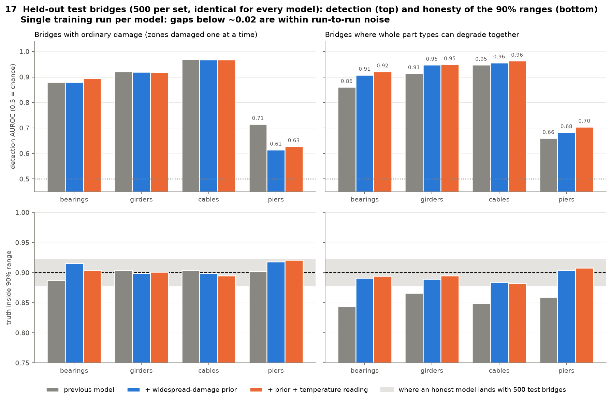
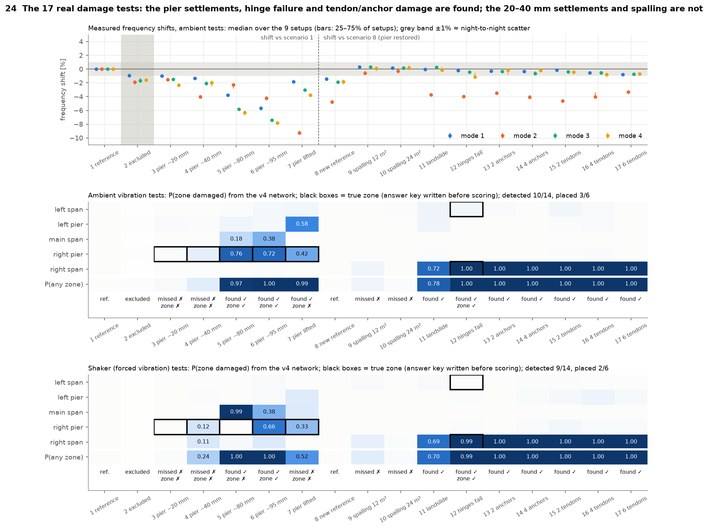
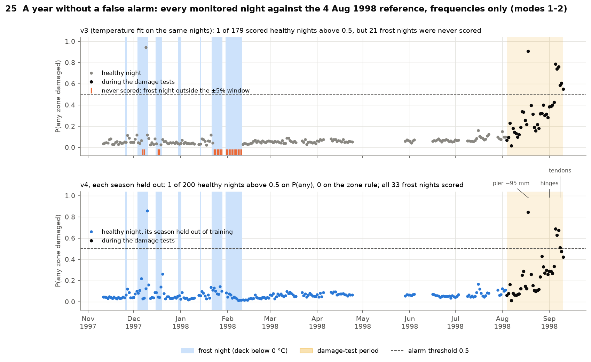
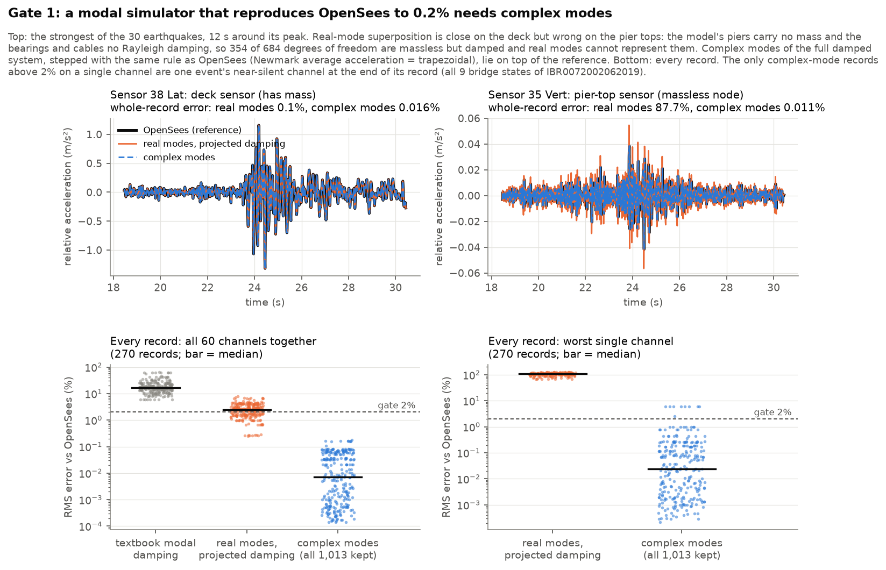
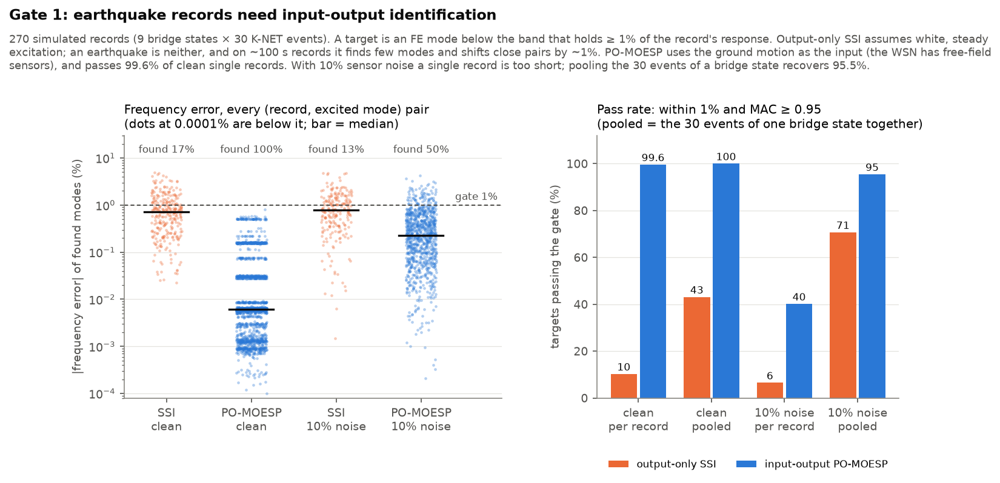

# label-free-shm

**Finding damage in real bridges with neural posteriors trained only on simulations, with no damage labels.**

The method has four steps:
1. Calibrate a finite-element (FE) model of a bridge to its measured vibration modes.
2. Simulate many healthy and damaged versions of it, with the nuisances real monitoring faces: an uncertain model, temperature and measurement noise.
3. Train a neural posterior estimator, which outputs how much stiffness each zone of the bridge has lost, together with honest uncertainty ranges.
4. Apply the trained network **unchanged** to real measurements.

Wherever a structure has real damage or a real change, the answer key is written and committed **before** the result is scored. Negative results are reported alongside positive ones.

*Work in progress (October 2026).*

## Results so far

| Structure | What was tested | Result |
|---|---|---|
| **Shin-Nakagawa Bridge** (530.8 m cable-stayed, Japan), simulated | A 3D OpenSees model calibrated to the 8 identified modes (all within 1.3%); 19 damage zones; neural posterior estimation | 90% ranges contain the truth 84–92% of the time. Detection AUROC is 0.86–0.97 for bearings, girders and cables. Piers stay at 0.61–0.71: the measured modes barely see them. |
| **IASC–ASCE benchmark frame** | The same pipeline on the published 4-storey frame | Recovers 4 of the 5 published damage patterns |
| **Z24 Bridge** (Switzerland; real, staged damage) | Trained on simulations only, then applied to a year of real monitoring and 17 real damage tests | Detects **10 of 14** damage scenarios and places 3 of the 6 with a known location. With each season held out of training, **1 of 200** healthy nights raises an alarm (0 of 200 under the zone rule). |
| **Shin-Nakagawa**, 270 simulated earthquake records (Gate 1) | Fast modal simulator against OpenSees; identifying modes from earthquake records | The complex-mode simulator matches OpenSees with a median error of **0.007%** (worst record 0.18%). Input–output identification passes **99.6%** of checks; output-only SSI passes 10%. |
| **KW51 railway bridge** (Belgium; real retrofit) | Python port of KU Leuven's published FE model; a pre-registered test of whether Z24's frost-memory temperature model transfers | Port: 11 of 14 modes within 3% (median 1.9%), which narrowly **fails** our own pre-registered bar. Frost memory **does not transfer** (§ below). |

## Key figures

### Calibrated uncertainty on held-out simulated bridges (Shin-Nakagawa)


- **Top:** how well damage is detected per part type, against a chance level of 0.5.
- **Bottom:** how often the 90% range contains the true stiffness. The shaded band is where an honest model lands with 500 test bridges.
- The piers are the hard case: the measured modes barely respond to pier damage.

### Real damage on Z24, scored against an answer key written first


- **Top:** measured frequency shifts per damage test.
- **Middle and bottom:** the network's probability that each zone is damaged, from ambient and shaker tests. Black boxes mark the true zone.
- The pier settlements, hinge failure and tendon/anchor damage are found. The smaller 20–40 mm settlements and the spalling are not.

### A year of monitoring with seasons held out


- Every monitored night is scored against a reference night.
- The final model (bottom) adds a "frost memory" for frozen asphalt, which the earlier version (top) lacked. It scores all 33 frost nights and raises 1 alarm in 200 healthy nights, against clear alarms during the damage tests.

### A modal simulator that reproduces OpenSees


- The FE model's damping is not proportional, so superposition with real modes is off by 17% (median).
- Complex modes reproduce OpenSees to 0.2% on all 270 records, in about 0.4 s per record.

### Identifying modes from earthquake records


- Output-only SSI assumes white-noise excitation, and an earthquake is not that. It fails on these records.
- Using the free-field ground motion as input (PO-MOESP) recovers the modes, including at 10% sensor noise once the events of one bridge state are pooled.

## A negative result: frost memory does not transfer to KW51

On Z24, a "frost memory" term (the cold accumulated over the previous weeks) removed the winter false alarms. KW51 was the pre-registered test of whether it carries over to another bridge. **It does not.**

- With one 50-day block held out at a time, frost memory adds 11.7 points of false alarms below 2 °C instead of removing them.
- The reason: KW51's healthy period holds a single frost episode, and it falls inside one block. A model that never saw frost cannot learn it.
- Under leave-one-out, our temperature-only baseline reproduces Neumann et al. (2024)'s 38% once their preprocessing (interpolating missing frequencies) is used: we get 36.8%.
- Every model still flags the 2019 retrofit in 100% of post-retrofit hours.
- Code: `scripts/e_kw51.py`; numbers: `results/e_kw51/e_kw51.json`.

## Repository layout

```
scripts/
  fe_model.py, calibrate.py            Shin-Nakagawa FE model (OpenSeesPy) and its calibration
  time_history.py, run_one_th.py,      earthquake time-history dataset (K-NET input, 9 bridge states x 30 events)
    gen_run_manifest.py, knet_parser.py, qa_output.py, check_damage_cases.py
  sbi_bridge.py, compare_sbi_variants.py   neural posterior estimation for the bridge
  iasc_asce.py, sbi_iasc.py            IASC-ASCE benchmark model and its SBI check
  ssi.py, g1_shin_nakagawa.py          system identification; Gate 1 (superposition + identification)
  kw51_model.py, kw51_fe.py            KW51 FE model in Python (StaBIL-equivalent beam/shell/constraint code)
  kw51_acceptance.py, e_kw51.py        KW51 FE acceptance check; the frost-transfer test
  w9_stage0.py                         checks on SeisGPT's public data
  make_figures.py, make_g1_w9_figures.py, export_modes.py, export_quakes.py   figures
results/                               summary JSON for every result quoted above
figures/                               figures 02-31 (00, 01 and 19 are left out)
```

**Not included:**
- the Z24 analysis code, which embeds details from licensed test documents;
- all third-party data (see below);
- the 1.3 GB simulated earthquake dataset.

## Setup

```bash
./setup_env.sh        # Python 3.11 venv via uv, pinned requirements, CPU-only torch
```

## Data (not redistributed here)

| Data | Source | Used by |
|---|---|---|
| K-NET strong-motion records (station IBR007) | NIED, free with registration, doi:10.17598/NIED.0004 | the time-history dataset |
| KW51 monitoring data | Maes & Lombaert, Zenodo 10.5281/zenodo.3745914 (CC BY-NC-SA 4.0) → `data/kw51/monitoring/` | `e_kw51.py`, `kw51_acceptance.py` |
| KW51 FE model | Maes, van de Velde & Lombaert, Zenodo 10.5281/zenodo.17366772 (CC BY-NC-SA 4.0) → `data/kw51/fe_model/` | reference for `kw51_model.py` |
| IASC–ASCE Phase I benchmark | Johnson et al. 2004, J. Eng. Mech. 130(1) | `iasc_asce.py` |
| SeisGPT public release | Figshare 10.6084/m9.figshare.29957834 (GPL-3.0+); set `SEIS_DIR` | `w9_stage0.py` |
| Z24 Bridge | KU Leuven Structural Mechanics, on request (non-commercial, no redistribution) | not included |

## Licence

- **Our code:** MIT (see `LICENSE`).
- **KW51 port files:** `scripts/kw51_model.py`, `kw51_fe.py` and `kw51_acceptance.py` are derived from KU Leuven's KW51 FE model, so they are licensed **CC BY-NC-SA 4.0**, as their headers state.
- **Figures 20–27** show Z24 data (KU Leuven). **Figures 30–31** show SeisGPT data (GPL-3.0+).

## Acknowledgements

- The Z24 data were provided by the Structural Mechanics Section of KU Leuven and are used under its non-commercial research licence. They are not redistributed.
- KW51 data and FE model: K. Maes, M. van de Velde and G. Lombaert (KU Leuven).
- Strong-motion records: NIED K-NET.
- Shin-Nakagawa identified modes: Siringoringo et al., J. Bridge Eng. 2022.
- SeisGPT data: the SeisGPT authors (Nature Communications, 2026).
